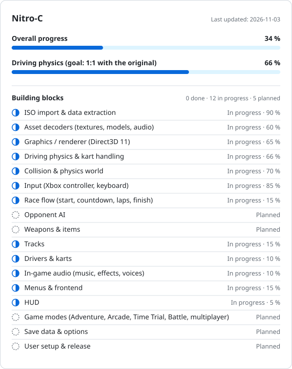

# Nitro-C – Crash Nitro Kart for Windows

A native PC reimplementation of Crash Nitro Kart, reverse-engineered from the PS2 version. No emulation.

**Driving should feel like the original** (acceleration, braking, steering, drifting, boosts, hops and jumps, surfaces and item hits on the kart). It is rebuilt from the original game logic and checked against it; nothing about the handling is made up.

**Everything around the driving is built new for PC:** race flow, menus, HUD, graphics and sound, with PC-style controls (Xbox controller, keyboard) and higher resolutions.

> **Note:** This project contains **no game data**. You need your own legally obtained copy of Crash Nitro Kart (PS2, NTSC-U, `SLUS_206.49`). All graphics, models, sounds and tracks are read locally from your ISO and are never distributed.

## Progress

The percentages are honest estimates by the developers. They are updated with every major step, so you can follow here what already works and what is still missing.

<!-- PROGRESS:START -->
<picture>
  <source media="(prefers-color-scheme: dark)" srcset="assets/progress-dark.svg">
  
</picture>

### Milestones

- ✅ Build foundation and ISO verification
- ✅ Import and decode resources
- ✅ Intro and PC main menu
- ✅ Original track textured in 3D
- ✅ 3D free drive with the original camera and an Xbox controller
- 🔧 Driving checked against the original code
- ✅ Own DirectX 11 renderer with fixed simulation tick
- ✅ Audio module (sounds, voices, music from your own ISO)
- 🔧 All 26 tracks and 16 drivers readable from the original files
- 🔧 First real race (start, laps, finish)
- ⬜ Opponents on the track
- ⬜ Weapons and items
- ⬜ All tracks, drivers and karts
- ⬜ PC menus, HUD and sound
- ⬜ All game modes including Adventure
- ⬜ First playable release

✅ done · 🔧 in progress · ⬜ open

<!-- PROGRESS:END -->

## Source code

The source code is not published yet. It will follow here as research into the game progresses. The port is built with CMake and Visual Studio 2022 for Windows 10/11 x64.

Game data is imported from your own ISO into a local folder on your machine and is never uploaded. A one-step import for new users is planned.

## How the port works

- **Not an emulator:** No PS2 code is executed. The original kart and driving logic is analyzed and rewritten as native C++.
- **Faithful driving:** The driving code is tested against the original game's own logic, including the PS2's floating-point rounding, so it feels like the original.
- **PC-native everything else:** Race flow, menus, HUD, rendering and audio are designed new for PC instead of copying the console's way of doing them.
- **Local data only:** The ISO, extracted files and analysis reports stay on your machine and are excluded from version control.

## Legal

Nitro-C is a fan project and is not affiliated with Activision, Vicarious Visions or Sony. "Crash Nitro Kart" and "Crash Bandicoot" are trademarks of their respective owners. No copyrighted game content, Sony SDK or PS2 BIOS is distributed.
